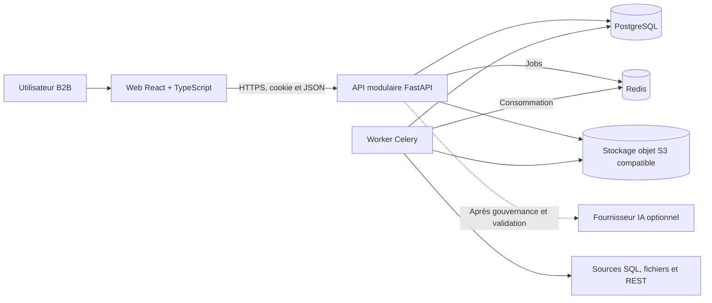
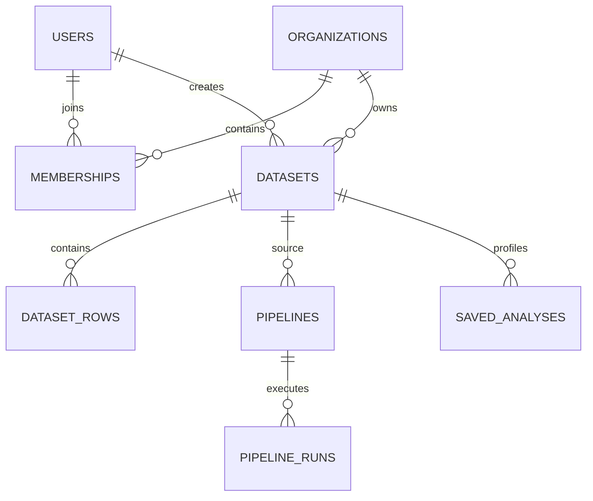

# NOOMIN — Rapport de lancement Phase 0

**Date :** 23 novembre 2026  
**Périmètre :** découverte, cadrage produit, architecture, UX et revue statique de sécurité.  
**État du code au cadrage :** `main`, commit `1f4f5ec` (`Expand analytics workspace with data profiles and charts`).  
**Statut :** Phase 0 consolidée ; Phase 1 préparée, non démarrée.

## 1. Synthèse CTO

NOOMIN dispose déjà d’un parcours fonctionnel autour des comptes, des organisations, du CSV, du profiling, des transformations et des premières analyses. Cela constitue une base de MVP interne, mais pas encore une plateforme BI complète ni un SaaS prêt à accueillir des clients.

La cible décrite dans le prompt maître est trop large pour être livrée comme un seul MVP. La décision de cadrage est de terminer d’abord un parcours étroit et vérifiable : **créer un espace → importer un CSV → contrôler les colonnes → explorer les données → transformer → consulter le résultat → conserver une analyse**. La gestion d’équipe et l’exploitation fiable doivent précéder un pilote externe. Les connecteurs, dashboards composables, Copilot et la facturation suivront dans cet ordre de dépendance.

### Décisions de cadrage

1. Conserver un **monolithe modulaire** avec API FastAPI et worker Celery séparé ; ne pas introduire de microservices avant un besoin mesuré.
2. PostgreSQL reste la base applicative cible ; SQLite ne sert qu’à l’aperçu local.
3. Redis/Celery restent la file de tâches initiale. Les jobs doivent devenir idempotents, traçables et relançables avant d’ajouter des flux ETL plus larges.
4. Un seul connecteur externe sera choisi après le pilote et les retours produit. CSV est le seul mode d’ingestion actuellement implémenté.
5. PostgreSQL/Redis/Celery, le stockage objet, l’IA, la facturation ou toute autre intégration ne seront montrés comme actifs qu’après un test réel.
6. Le stockage S3 compatible est une cible pour conserver les fichiers sources et exports ; il n’est pas une dépendance nécessaire au MVP CSV actuel. Le seuil de migration hors stockage JSON en base reste à décider avant d’augmenter les volumes.
7. Aucun développement de Text-to-SQL ne commence avant une couche sémantique gouvernée, des permissions testées et un modèle de menace dédié.

## 2. Architecture existante et cible

### État observé

Le dépôt est un monolithe applicatif en démarrage : frontend React/TypeScript, API FastAPI, PostgreSQL prévu, SQLite pour aperçu local, Redis/Celery déclarés pour les travaux asynchrones. Les routes sont séparées par domaine mais la logique reste partiellement dans les routeurs. L’interface et ses vues sont principalement réunies dans `apps/web/src/App.tsx`; les appels API reposent sur un client `fetch` maison.

Modules réellement présents :

- Identité : inscription, connexion, déconnexion avec révocation de session.
- Organisations et adhésions : création à l’inscription, membership et rôles de base.
- Données : import CSV, aperçu, suppression, profil descriptif.
- Pipelines : sélection, renommage, filtres, exécutions Celery.
- Analyses : histogrammes numériques sauvegardés et exploration catégorielle dans l’interface.
- Santé : disponibilité de l’API et contrôle PostgreSQL.

### Diagramme de conteneurs cible



Le stockage objet, les sources externes et le fournisseur IA sont des éléments **cibles**, pas des capacités installées actuellement.

### Modèle de données

Entités actuelles :



Les prochaines entités ne sont pas à créer en avance de phase ; elles seront ajoutées avec leur module : `invitations`, `data_connections`, `ingestion_jobs`, `quality_rules/results`, `data_models/relationships/measures`, `dashboards/widgets/filters`, `ai_conversations/messages`, `plans/subscriptions/usage_counters`, `audit_events`. Les ressources locataires devront porter et vérifier `organization_id`; les références entre ressources devront aussi garantir la cohérence du tenant au niveau du service et, lorsque pertinent, des contraintes relationnelles.

### Contrats déjà présents

Préfixe API `/api/v1`; session par cookie HTTP-only et organisation active via `X-Organization-ID`.

- Auth : `POST /auth/register`, `POST /auth/login`, `GET /auth/session`, `POST /auth/logout`.
- Données : `GET|POST /datasets`, `GET|DELETE /datasets/{id}`, `GET /datasets/{id}/profile`.
- Pipelines : `GET|POST /pipelines`, `GET /pipelines/{id}`, `POST /pipelines/{id}/runs`.
- Analyses : `GET|POST /analyses`.
- Santé : `GET /health`.

Conventions à établir avant les domaines suivants : pagination bornée, erreurs API uniformes, validation tenant dans chaque route/service/tâche, job long retournant `202` puis statut consultable, stratégie CSRF pour les cookies et versionnement des définitions mutables.

### Arborescence cible progressive

La cible est une séparation par domaines, sans réécriture du code existant :

```text
apps/web/src/
  app/                 # routes, providers et shell
  features/             # auth, organisations, datasets, pipelines, analytics...
  components/           # composants partagés accessibles
  lib/                  # client API et utilitaires
apps/api/noomin_api/
  api/v1/                # routeurs et dépendances HTTP
  core/                  # configuration, sécurité, erreurs, logs
  db/                    # session, metadata et migrations
  modules/               # identity, organizations, ingestion, pipelines...
  workers/               # tâches et orchestration
apps/api/tests/
  unit/ integration/ security/ contract/
docs/
  architecture/ adr/ api/ runbooks/
infra/
  compose/ ci/
```

Le frontend cible du prompt comprend React Router, React Query et une bibliothèque de visualisation dédiée. Ces dépendances ne sont pas encore installées. Introduire chacune lorsqu’un besoin la justifie et inclure ses tests, plutôt que réorganiser tout le dépôt avant d’avoir des contrats stables.

## 3. PRD du MVP

### Objectif

Permettre à une petite équipe de comprendre et préparer ses données tabulaires, à partir d’un CSV, au sein d’un espace isolé par organisation.

### Utilisateurs

- **Propriétaire/analyste** : importe, profile, transforme et sauvegarde des analyses.
- **Lecteur** : consulte les données et analyses sans les modifier.

Les rôles actuels (`owner`, `admin`, `member`, `viewer`) ne définissent pas encore une matrice de permissions distincte. L’interface et l’API doivent s’aligner sur une matrice avant d’ajouter des fonctions d’administration.

### Inclus au MVP

- Authentification e-mail/mot de passe, session et déconnexion.
- Une organisation par inscription et isolation tenant.
- CSV UTF-8, limites explicites, séparateurs courants, aperçu et erreurs compréhensibles.
- Profil de colonnes : type, valeurs présentes, valeurs distinctes, catégories fréquentes et distribution numérique.
- Transformations disponibles : sélection, renommage et filtres.
- Statuts de pipeline et jeu de données de sortie.
- Analyses sauvegardées et consultables.
- Suppression d’un jeu de données avec confirmation des dépendances.
- Installation reproductible et documentation de limites.

### Hors MVP initial

Connecteurs SQL/Excel/API, synchronisation incrémentale, modélisation sémantique, dashboards composables, partage/export PDF/Excel, Copilot/LLM, facturation/Stripe, quotas commerciaux, planification de pipelines et administration globale.

## 4. Backlog et critères d’acceptation

### NOW — fermer le parcours et le rendre vérifiable

**P0.1 — Permissions cohérentes**
- Définir les actions par rôle : lire, importer, supprimer, créer/lancer un pipeline, administrer les membres.
- Appliquer les décisions côté API et ajouter les tests positifs et négatifs.
- Un utilisateur ne peut accéder à aucune ressource d’un autre tenant, y compris via une tâche asynchrone.

**P0.2 — Fiabilité import CSV**
- Limites affichées et imposées côté API.
- Délimiteurs et guillemets reconnus ; en-têtes vides/dupliqués et lignes irrégulières donnent un diagnostic compréhensible.
- Aucun import partiel ni résultat trompeur après erreur.

**P0.3 — Exécutions vérifiables**
- Historique consultable avec statut, horodatages, durée, volume, sortie et message d’échec.
- Les répétitions ne créent pas de résultat incohérent ; une source supprimée pendant une exécution a un comportement défini.
- Écart actuel : l’API expose seulement la dernière exécution d’un pipeline ; elle ne donne pas l’historique complet ni le volume traité.

**P0.4 — Installation et exploitation minimale**
- Démarrage propre Docker Compose sur PostgreSQL, Redis et worker, migrations incluses.
- Liveness séparée de readiness ; readiness vérifie les dépendances réellement requises.
- Procédure de sauvegarde et restauration testée avant tout pilote.
- Aucune valeur secrète de développement acceptée en environnement production.

**P0.5 — Parcours UI complet**
- Inscription → import → aperçu/profil → analyse → pipeline → sortie → suppression.
- Chaque étape expose des états vide, chargement, réussite et erreur accessibles.
- Pas d’entrée qui ressemble à une fonction active si elle n’a pas de backend réel.

### NEXT — équipe pilote

1. Membres, invitations à durée limitée, attribution et révocation de rôle.
2. Sélecteur d’organisation fonctionnel pour les utilisateurs multi-organisation.
3. Matrice RBAC et tests d’autorisation systématiques.
4. Historique et détails d’exécutions.
5. Choisir un premier connecteur externe après observation du segment pilote.

### LATER — extension BI et commercialisation

1. Connecteurs additionnels, stockage objet et ingestion versionnée.
2. Règles et résultats de qualité de données.
3. Modèles, relations, dimensions, mesures et couche sémantique.
4. Dashboards configurables, filtres, drill-down, partage et exports.
5. Copilot contrôlé par la couche sémantique, permissions, limites de coût, tests et audit.
6. Plans, quotas, Stripe, administration SaaS et opérations de production étendues.

## 5. Spécifications UX/UI

### Design system MVP

- Couleurs : Midnight Navy `#101827`, Electric Blue `#2563EB`, Cyan `#06B6D4`, Cloud `#F1F5F9`, blanc.
- Inter comme police unique cible ; la page actuelle charge aussi DM Sans en solution de repli.
- Boutons, formulaires, tableaux, badges, notifications, confirmations et états d’attente cohérents.
- Texte en français direct ; statut fonctionnel distinct de toute capacité future.
- Typographie actuelle parfois trop petite : priorité à la lisibilité des formulaires, tables et statistiques.

### Navigation recommandée

Vue d’ensemble, Jeux de données, Pipelines, Analyses. Ajouter Organisation/Paramètres seulement avec une vraie fonctionnalité. Les vues actuelles sont pilotées par un état React, sans URL de page partageable ; le sélecteur d’organisation, la cloche, l’aide et la ligne « Accès et membres » restent des placeholders.

### Parcours de référence

Créer un compte → importer → vérifier l’aperçu → lire le profil → explorer/sauvegarder une analyse → créer/lancer une transformation → consulter le dataset produit.

### Accessibilité et mobile

- Garder un focus clavier visible, des libellés reliés aux champs et des statuts exprimés par texte, pas uniquement par couleur.
- Proposer une table ou un résumé lisible des valeurs des graphiques, en complément du tracé.
- Vérifier contrastes, zoom, taille de texte et cibles tactiles.
- La navigation mobile ne doit pas dépendre de la seule icône pour identifier une page.
- Les importations, suppressions et exécutions doivent annoncer les états aux technologies d’assistance et conserver le contexte après erreur.

## 6. Revue sécurité — modèle de menace initial

### Actifs et frontières

Actifs : comptes/sessions, données CSV et analyses, organisations, pipelines et secrets futurs des connecteurs. Frontières : navigateur ↔ API, API ↔ PostgreSQL, API/worker ↔ Redis, et futurs connecteurs externes.

### Contrôles présents

- Hachage Argon2 via `pwdlib` ; cookie HTTP-only, SameSite=Lax, Secure hors développement.
- Révocation des sessions par version côté utilisateur.
- Contrôle d’appartenance à l’organisation sur les routes inspectées.
- Plafonds de taille/volume CSV et accès SQL via SQLAlchemy.

### Risques prioritaires

| Priorité | Risque observé | Mesure avant pilote |
|---|---|---|
| Haute, si déploiement exposé | Compose publie les ports PostgreSQL/Redis/API, Redis sans authentification visible, valeurs par défaut et Uvicorn `--reload`. | Profil dev/prod distinct, ports DB privés, Redis protégé, secret obligatoire, serveur sans reload. L’exposition publique n’a pas été vérifiée. |
| Haute | Pas de limitation visible des inscriptions/tentatives de connexion ; inscription publique. | Rate limiting, surveillance des échecs, décider inscription ouverte ou invitation, vérification/récupération de compte. |
| Haute avant données clients | Pas de sauvegarde/restauration, rétention et chiffrement au repos documentés dans le dépôt. | Définir exigences TLS/stockage, durée de conservation, effacement et sauvegarde chiffrée restaurable. |
| Moyenne | CSRF dépend surtout de SameSite/CORS ; pas de validation d’origine visible. | Vérification Origin sur mutations et/ou token CSRF adapté au déploiement. |
| Moyenne | Rôles peu différenciés ; isolation surtout portée par le code applicatif. | Matrice RBAC, tests cross-tenant par endpoint et contraintes tenant-aware lorsque pertinentes. |
| Moyenne | Import chargé en mémoire, pas de quota par organisation ni limite de concurrence visible. | Quotas, limites de concurrence, tests de charge/imports malformés. |
| Basse à moyenne | En-têtes HTTP de sécurité non visibles dans Nginx. | Définir CSP/HSTS et responsabilité du proxy public. |

Cette revue est statique, ciblée et n’est pas un audit de sécurité ni un test d’intrusion. Aucun risque critique n’a été confirmé dans son périmètre limité.

## 7. Architecture de test et portes de release

État vérifié avant le cadrage : 12 tests API passaient, build et lint frontend passaient. Ces résultats ne prouvent pas le démarrage Compose complet ni le comportement contre PostgreSQL/Redis réels ; aucune suite frontend E2E n’est présente.

À ajouter progressivement :

- Unitaires : parsing/profiling/transformations.
- Intégration : PostgreSQL, migrations vierges et upgrade, Redis/Celery.
- Sécurité : cross-tenant, permissions par rôle, CSRF/rate-limit.
- Parcours browser : inscription/import/profil/pipeline/suppression.
- Exploitation : readiness, sauvegarde et restauration, démarrage d’environnement propre.

### Releases proposées

**R0 — MVP interne :** parcours CSV complet et tests d’isolation ; aucune donnée client externe.  
**R1 — pilote privé :** Compose PostgreSQL/Redis/Celery validé, sauvegarde/restauration, revue sécurité ciblée et supervision minimale.  
**R2 — équipe :** invitations, membres, organisation sélectionnable, RBAC et historique d’exécutions.  
**R3 — extension BI :** premier connecteur choisi, modèles sémantiques puis dashboards. Copilot et billing après validation du besoin et des contrôles.

## 8. Rôles et coordination

La phase 0 a fait contribuer les spécialités **Product Manager**, **Software Architect**, **UX/UI Designer** et **Security Engineer** ; le CTO consolide et arbitre. L’environnement permet au maximum quatre agents actifs en même temps, CTO compris. Les autres spécialités du prompt — Backend, Frontend, Data Engineering, BI/Semantic, AI, DevOps, QA et Technical Writing — sont à mobiliser séquentiellement sur les tâches qui les concernent, sans prétendre qu’elles ont déjà produit un livrable.

Le rapport a reçu une revue QA indépendante : verdict accepté, avec la précision sur l’historique des exécutions intégrée ci-dessus. La revue n’a pas relancé les tests ; les 12 tests API, le build et le lint mentionnés plus haut correspondent à la vérification précédente du code.

### Affectations préparées pour Phase 1

| Travail | Rôle responsable | Dépendances | Résultat attendu |
|---|---|---|---|
| Matrice permissions + tests tenant | Backend + Security + QA | Décision produit sur actions/rôles | Dépendances réutilisables et tests négatifs par ressource |
| Compose/dev-prod + migrations + readiness | DevOps + Backend + QA | Environnement Docker et décisions secrets | Démarrage PostgreSQL/Redis/worker reproductible |
| Historique et robustesse pipelines | Data Engineer + Backend + QA | Statuts et contrats d’exécution | Historique, erreurs utiles, re-run/idempotence définis |
| Parcours UI et accessibilité | UX + Frontend + QA | Contrats API validés | Parcours sans placeholders actifs, états et tests browser |
| Membres et invitations | Product + Backend + Security + Frontend | Matrice RBAC et décision e-mail | Gestion de membres multi-tenant sécurisée |

## 9. Questions produit ouvertes et valeurs par défaut proposées

Ces décisions peuvent être confirmées au fil du premier pilote ; elles ne bloquent pas le cadrage :

1. **Segment pilote :** commencer par petites équipes Finance/Opérations manipulant des exports tabulaires ; confirmer avec les premiers utilisateurs.
2. **Connecteur après CSV :** choisir une seule source avec un pilote réel, plutôt que promettre SQL Server/PostgreSQL/MySQL/Excel/REST simultanément.
3. **Volume :** garder les limites actuelles de 20 000 lignes et 10 Mo jusqu’à un benchmark et un besoin confirmé.
4. **Conservation :** définir une durée et une procédure d’effacement avant pilote externe.
5. **Nom :** NOOMIN reste provisoire, à vérifier côté marque et domaine.

## 10. Registre de décisions initial

| ID | Décision initiale | Statut |
|---|---|---|
| ADR-001 | Monolithe modulaire + API et worker séparés | Adoptée pour le MVP |
| ADR-002 | PostgreSQL source de vérité ; SQLite aperçu local uniquement | Adoptée |
| ADR-003 | Celery/Redis pour jobs au démarrage, avec statuts persistés en base | Adoptée ; fiabilité/idempotence à renforcer |
| ADR-004 | Stockage JSON/JSONB conservé pour le petit CSV plafonné ; définir seuil avant croissance | Provisoire |
| ADR-005 | S3 compatible pour originaux/export futurs, pas requis au MVP courant | À implémenter quand le besoin est validé |
| ADR-006 | Cookie HttpOnly conservé ; définir CSRF, rate limit et récupération compte avant pilote | Partielle |
| ADR-007 | Reporter le moteur sémantique externe ; fixer d’abord les contrats KPI métier | Différée |
| ADR-008 | Aucun fournisseur IA choisi ; abstraction après cadrage sécurité/coût/données | Différée |
| ADR-009 | Stripe différé jusqu’aux plans, quotas et règles d’usage | Différée |

## 11. Limites de ce rapport

Les spécialisations Product, Architecture, UX et Security ont effectué une inspection en lecture seule. Le rapport n’est ni une validation de production ni un audit dynamique. L’exécution PostgreSQL/Redis/Celery en environnement propre, les tests E2E, les sauvegardes et une revue d’intrusion restent à faire dans les phases prévues.
